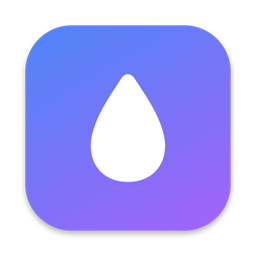

<p align="center">
  
</p>

<h1 align="center">Distill</h1>

<p align="center"><b>Documents in. AI-ready Markdown out.</b></p>

<p align="center">
  
  
  
</p>

Distill is a small, fast, fully native macOS app that converts documents into
clean Markdown — the most token-efficient format for feeding context to AI
models. Drop files in, get tidy `.md` files out, paste them into your LLM of
choice.

Everything runs **on-device**. No network calls, no accounts, no telemetry.

## Features

- **11 input formats**, all converted natively (see table below)
- **OCR fallback** — scanned/image-only PDF pages are recognized on-device
  with the Vision framework, per page
- **Token estimates** for every converted file, so you know what a document
  costs before pasting it into a context window
- **Rendered or raw preview** of the generated Markdown, with one-click Copy
- **Finder integration** — right-click → Quick Actions → *Convert to
  Markdown*, or Open With → Distill
- **Watch folder** — drop files into a chosen folder and they convert
  automatically while Distill runs
- **Auto-copy** the result to the clipboard after single-file conversions
  (optional)
- Never overwrites: outputs get `-2`, `-3`, … suffixes
- Sandboxed, light & dark mode, keyboard-friendly (⌘O add, ⌘⏎ convert)

## Supported formats

| Format | How it's converted |
| --- | --- |
| PDF | PDFKit text extraction; Vision OCR for pages without a text layer |
| Word (.docx) | OOXML parsed directly — headings, bold/italic, lists, tables |
| PowerPoint (.pptx) | One section per slide: title, body bullets, speaker notes |
| Excel (.xlsx) | One Markdown table per sheet (via CoreXLSX) |
| Legacy Word / RTF (.doc, .rtf) | macOS's built-in `textutil`, then the HTML pipeline |
| HTML (.html, .htm) | Custom tolerant parser → headings, links, lists, tables, code |
| CSV / TSV | RFC-4180-style parser → Markdown tables |
| Text / Markdown (.txt, .md) | Cleanup passthrough (line endings, blank-line runs) |

## Install

1. Download `Distill-x.y.z.zip` from the latest
   [GitHub Release](../../releases), unzip, and move `Distill.app` to
   `/Applications`.
2. **First launch:** the app is not yet notarized, so right-click
   `Distill.app` → **Open** → **Open**. (Only needed once.)
3. To enable the Finder Quick Action: launch Distill once, then check
   System Settings → General → Login Items & Extensions if it doesn't
   appear under right-click → Quick Actions.

## Build from source

Requirements: Xcode 26 on macOS.

```sh
git clone <this-repo>
cd Distill
open Distill.xcodeproj   # then ⌘R
```

Or from the command line:

```sh
xcodebuild -scheme Distill -configuration Release build
```

The two Swift package dependencies (ZIPFoundation, CoreXLSX) resolve
automatically on first build.

## Architecture notes

- **Two targets**: the app, and a Finder Quick Action extension that hands
  selected files to the app through Launch Services (which is what
  transfers sandbox read access — the extension itself converts nothing).
- **One protocol, eleven converters**: everything implements
  `MarkdownConverting` (`Converters/`); adding a format is one type plus
  one line in `ConversionEngine`.
- **Concurrency**: the UI runs on the main actor; conversion hops to a
  background thread through a single `@concurrent` entry point. Sync
  converters satisfy the async protocol requirement for free.
- **Sandbox**: writing "next to the source file" isn't automatically
  allowed for a sandboxed app, so `FolderAccessManager` handles the
  probe → stored security-scoped bookmark → one-time Grant Access panel
  flow. Grants persist across launches.
- **No non-native code**: Apple frameworks plus two Swift packages
  (ZIPFoundation for OOXML unzipping, CoreXLSX for spreadsheets). The
  DOCX/PPTX/HTML parsers are hand-written Swift.

## Privacy

Distill never touches the network. Files are read, converted in memory,
and written back to disk — OCR included (Apple's Vision framework runs
locally).

## License

[MIT](LICENSE) © 2026 Rakan Hamadeh
